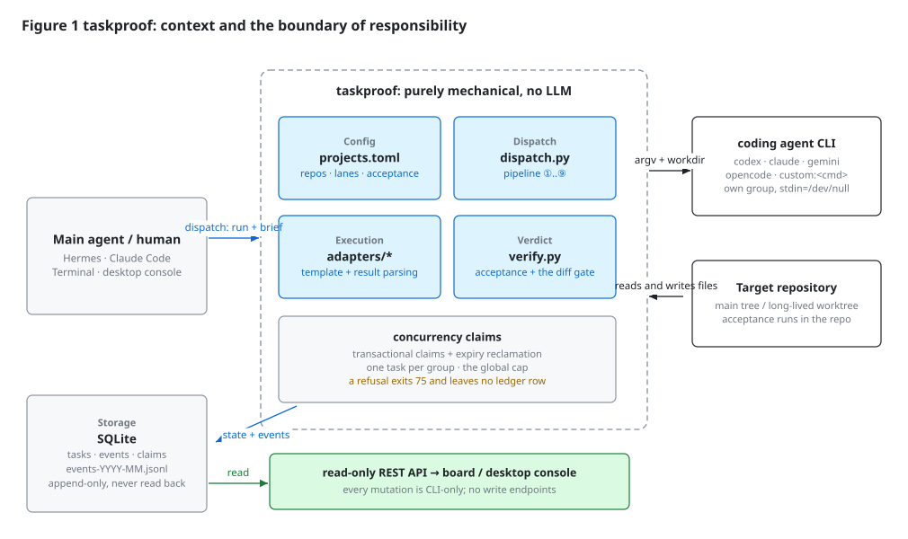
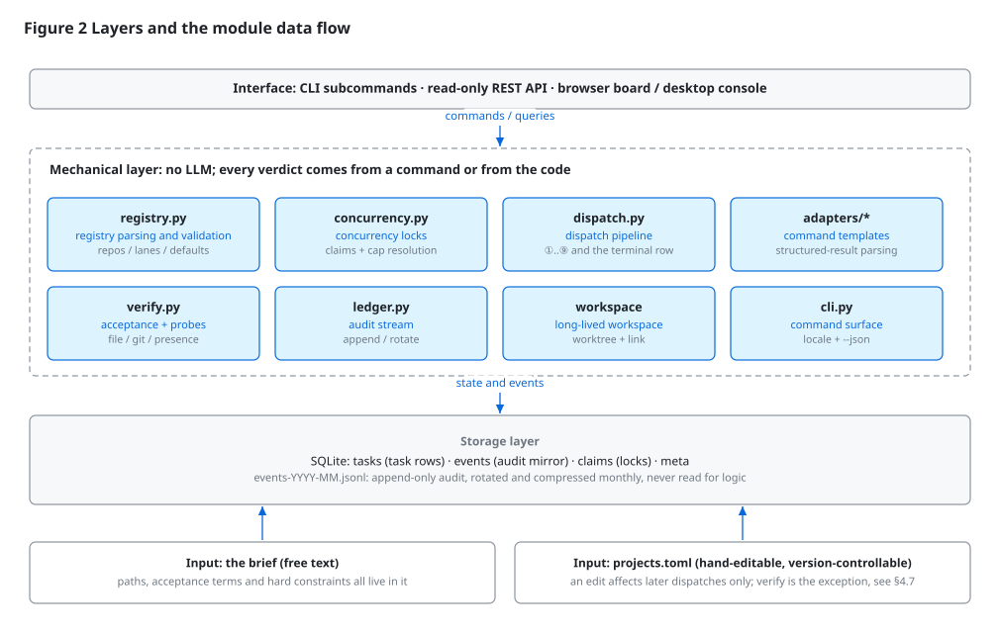
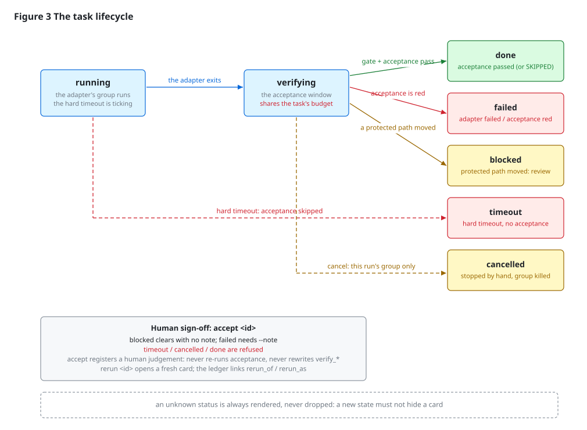
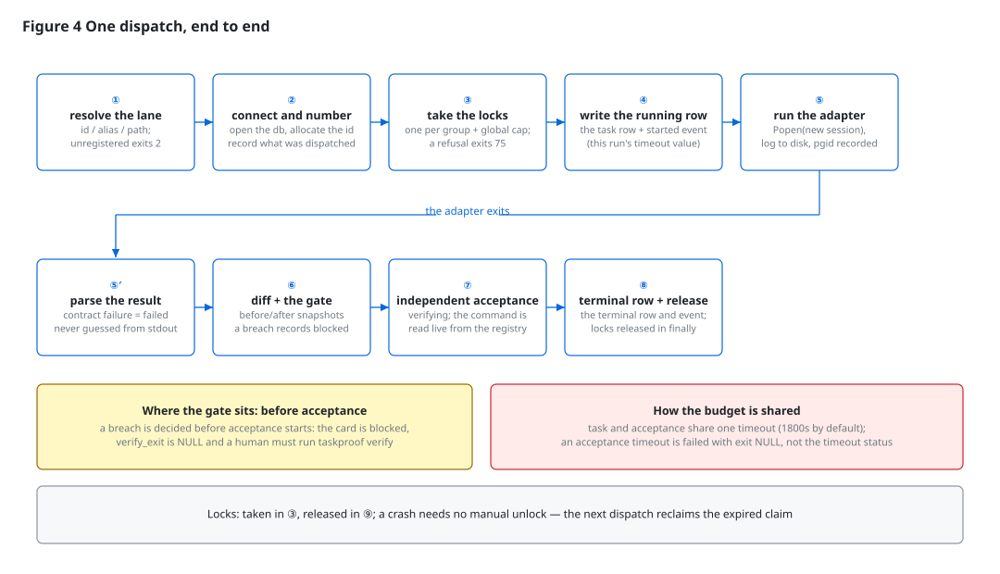
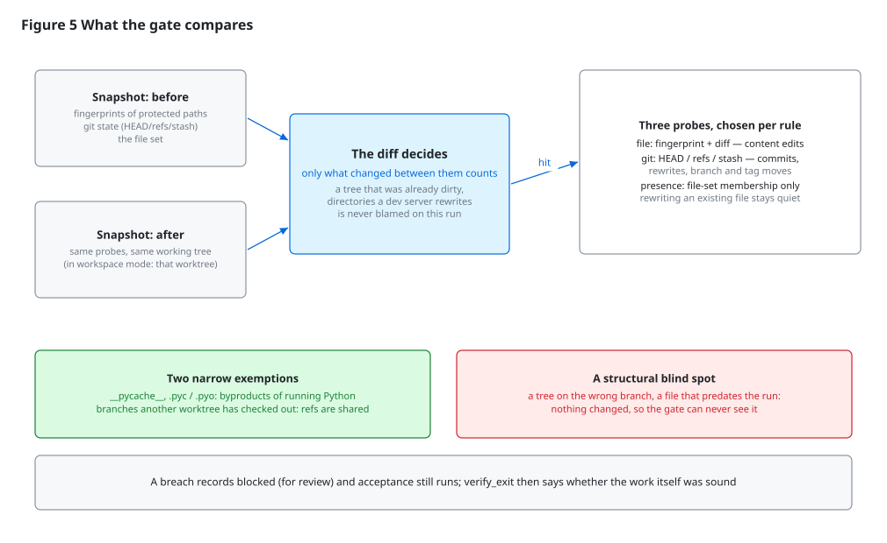
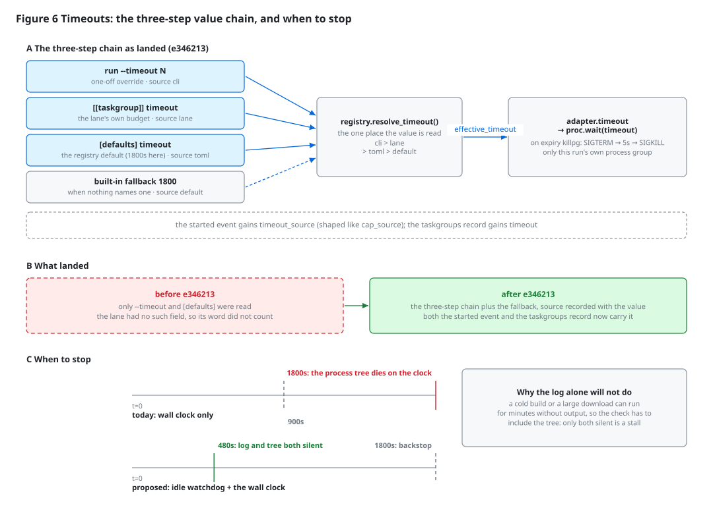

# Architecture

**English** · [简体中文](ARCHITECTURE.zh-CN.md)

> Observed 2026-10-15 against v0.4.0. Sections 2 to 4 describe **current
> behaviour** and cite `file:line`; section 5 is what was measured; section 6 is
> proposed work, with the landings marked in place — do not read the unmarked
> parts as shipped behaviour.
> The decision log and the invariants behind this design are in
> [`DESIGN.md`](DESIGN.md).

## Abstract

taskproof is a dispatch and acceptance layer that produces no judgements of its
own: it does not decide *what* to do, it only guarantees that whatever was
dispatched is **independently verified** and **faithfully recorded**. It is built
around one failure mode of coding agents: **a self-report can disagree with the
facts** — a claim of "verified in the browser" with no browser activity in the
event stream, a claim of success against a failing acceptance command, or edits
to paths the operator protected. The design answers that by taking the verdict
away from the worker: the acceptance command comes from configuration and runs
after the agent exits, the boundary check is a before/after difference, the
terminal state is written by the mechanical layer, and the audit stream is
append-only and never read back. This document gives the system context, the data
model, the key mechanisms, one measured evaluation of the timeout path, and seven
defects with the design changes that close them; several of those changes have
since landed — the per-lane timeout (`e346213`), the idle watchdog (`46ad07ad`),
the timeout sign-off (card 90) and unknown-key visibility (card 88) — and the rest
are still proposed.

Keywords: dispatch layer; independent acceptance; protected paths; difference
detection; hard timeout; idle detection; append-only audit

## 1 Introduction

### 1.1 Motivation

Comparable tools (multi-agent orchestrators, kanban boards for agents) compete on
orchestration breadth and interface, and take the worker's trustworthiness for
granted. A few weeks of dogfooding surfaced four factual failures:

    agent claimed "verified in the browser / screenshot taken"  -> no browser action in the event stream
    agent went out of scope                                     -> attempted a login POST with a guessed password
    agent's structured result arrived wrapped in a markdown fence -> parse failed; the run looked empty
    agent reported success                                      -> the acceptance command failed when run independently

What the four have in common: **the worker's own account cannot be the basis of a
verdict.** Hence the one governing rule — every verdict is produced by something
other than the process being judged.

### 1.2 Design goals

    G1  Dispatch implies acceptance: the command comes from configuration and runs
        after the agent exits, independently of anything the agent said
    G2  A boundary breach always leaves a trace, attributed by the machine
    G3  Records cannot be argued with: state in SQLite, events append-only and
        never consulted for logic
    G4  One mechanical layer: no LLM, no orchestration brain, no automated git writes
    G5  Concurrency is explainable: a limit is always shown together with its source

### 1.3 Non-goals

    Task decomposition, failure diagnosis and retry policy
    A multi-agent conversation layer; code generation or editing
    Automated commit or push — every git write is a human act

### 1.4 Terms

    lane / taskgroup   a dispatchable unit: id, owning project, path, acceptance
                       command, protected paths
    project            a repository identity and default path; not dispatchable
    brief              the free-text task description handed to the agent
    dispatch           one `run` call, i.e. one row in the task table
    workspace          a git worktree taskproof creates for a lane and reuses

## 2 Overall design

### 2.1 The boundary

One question draws the line: **which steps can a machine judge, and which only a
human can**.

    machine   is the process alive; a command's exit code; the difference in
              protected paths before and after; the acceptance exit code;
              whether a concurrency slot is free
    human     whether a breach is acceptable, whether a red acceptance is a false
              red, whether a half-finished tree is worth keeping

The write surface is therefore kept tiny: the CLI is the only way in, the REST
API is **read-only**, and the desktop console and the browser board share one
rendering layer. That turns "who can change state" into an enumerable question
rather than one you reconstruct from an audit log.

### 2.2 Layers and modules

Three layers. The interface layer parses arguments and presents; the mechanical
layer contains no model calls and derives every verdict from a command or from
the code; the storage layer separates *state* (SQLite, queried by logic) from
*audit* (JSONL, never read).

    registry.py     parses and validates projects.toml (projects / lanes / defaults)
    concurrency.py  claims and global-cap resolution, always with a source
    dispatch.py     the pipeline ①..⑨, the only writer of task state
    adapters/*      "one command template plus one result convention" — codex,
                    claude, gemini, opencode, custom:<cmd>
    verify.py       independent acceptance and the three difference probes
    ledger.py       append and rotate the audit stream; never queried
    cli.py          the command surface (localised human output, --json for machines)

### 2.3 Configuration and runtime state stay apart

Configuration is `projects.toml`: hand-editable, version-controllable in the
user's own repository, and effective for **subsequent** dispatches. Runtime state
always goes to SQLite. Keeping them apart means a typo in a config file can never
corrupt history, and history can never become an implicit default for config.

An effective value is always shown together with where it came from
(`taskproof config --show`):

    concurrency = 5 (projects.toml)
    timeout     = 1800 (projects.toml)

That comes from G5: the global cap has three possible sources — `run --cap N`, the
registry's `[defaults] concurrency`, and a machine-derived fallback
(`clamp(2, cores // 4, 6)`; 2 when RAM is under 8 GB; 3 when the core count is
unavailable — `concurrency.py:114`). A bare number would make "why only five
slots" unanswerable.

### 2.4 Stack and constraints

    Python 3.11+, standard library only (sqlite3 / subprocess / json /
        http.server / argparse / tomllib)
    pipx for installation, --editable supported so a source change takes effect
        immediately
    Apache-2.0: this tool's value depends on being adopted, so no copyleft
    Employer-asset hygiene: no organisation-specific names or private addresses in
        the repository. The shipped scanner rules describe shapes only; the
        organisation word list lives outside the repository
        (~/.taskproof/asset-patterns.txt)

## 3 Data model and lifecycle

### 3.1 Relational schema

> Table 1 — `src/taskproof/sql/schema.sql`

    tasks     id / project / group_name / brief / status / adapter / model /
              reasoning / attempt / exit_code / pid / pgid / workdir / result_path /
              verify_cmd / verify_exit / files_changed / created_at / started_at /
              finished_at
    events    the audit mirror, same origin as JSONL: id / task_id / ts / event / payload
    claims    the concurrency guard: scope (group:<g> | global) / task_id / pid /
              claimed_at / expires_at
    meta      key-value odds and ends

Two trade-offs are worth recording. First, after the registry gained its two
layers, `tasks.project` holds the **lane id** and `group_name` holds the lock name
(by default the lane id; two lanes may deliberately share one lock name) — rows
written earlier stay readable, so no migration was needed. Second, concurrency uses
a `claims` table with `expires_at` rather than lock files: after a crash the next
dispatch reclaims the expired claim, and no stale lock is left for a human to clear.

### 3.2 Why the audit stream is not queried

The state store answers "what is the state now"; the audit stream answers "what
happened". The stream is append-only (`ledger.py:37`), rotated and compressed
monthly (six months kept) and tolerant of a torn line. Architecturally it is
**never used for a decision** (the write path from `dispatch.py:405` lands in both
SQLite and JSONL). That split removes the "two sources of truth" problem
altogether: the ledger can be lost without affecting a verdict.

### 3.3 Lifecycle

Five terminal states: `done` / `failed` / `blocked` / `timeout` / `cancelled`.

    running      the adapter's process group runs; the hard timeout is ticking
    verifying    the acceptance window — the state is written *before* the command
                 starts, so a hung acceptance is still visible
    done         acceptance passed, or acceptance was recorded SKIPPED
    failed       the adapter failed, or acceptance ran and was red
    blocked      a protected path moved; a human must review
    timeout      the hard timeout fired, the process tree was killed, acceptance
                 never ran
    cancelled    a human stopped it (only this dispatch's own process group dies)

### 3.4 Terminal states and human sign-off

`blocked` means "needs human review", not "the work is bad": a breach is a fact
about the run, not a verdict on the artefact, so it stays separate from `failed`.
A breach never short-circuits the pipeline — acceptance still runs and both facts
land in the ledger (the `forbidden` event names the paths, the `verify` event
carries the real result), and a breach outranks a red acceptance.

The human sign-off is `accept <id>`, a **registration** rather than a verdict: it
never re-runs acceptance and never rewrites `verify_*`. A `blocked` card clears
without a note (a green acceptance earns `done`, a red or skipped one earns
`failed`); a `failed` card requires `--note`, because a failure that is being
cleared has to survive on the record. A `timeout` card is accepted the same way —
`--note` required — but it is only **registered**: it stays `timeout` and the
ledger gains one `accepted` event whose `from` and `to` are both `timeout`, so
half-finished work never enters the completion count. `done` and `cancelled` are
still refused (`dispatch.py`'s `accept_task`). Redoing work is a separate act:
`rerun <id>` opens a fresh card from a terminal one and links the pair in the
ledger (`rerun_of` / `rerun_as`).

Two hard rules: an unknown status is always rendered, never dropped in silence;
and `accept` never quietly rewrites the facts of the run it closes.

## 4 Key mechanisms

### 4.1 The dispatch pipeline

One dispatch is a straight line of nine steps, of which the fifth takes almost all
the wall time. One precondition sits in front of the third, and it is decided
before anything is written down:

    ① resolve the lane (id / alias / path); unregistered exits 2
    ①′ the branch gate: a lane that declares `branch` must find a tree that can
      honour it; a mismatch exits 78 and leaves no ledger row
    ② prepare and connect the workspace (creating the db when needed)
    ③ take the locks: one per group plus the global cap; a refusal exits 75 and
      leaves no ledger row
    ④ write the running row and the started event (this run's timeout and cap,
      each with its source)
    ⑤ run the adapter: Popen with start_new_session, stdin from /dev/null,
      stdout/stderr streamed to logs/<id>.log while it runs, pgid recorded, and the
      hard-timeout clock started
    ⑤′ parse the structured result; a parse failure is an adapter failure — the
      verdict is never guessed from stdout
    ⑥ the difference and protected-path gate
    ⑦ independent acceptance (the `verifying` state is written first)
    ⑧ the terminal row and its events; the locks are released in `finally`

Two consequences are worth stating. The gate (⑥) runs *before* acceptance (⑦), so
a run that breaches a boundary never ran acceptance at all — its `verify_exit` is
NULL and a human has to run `taskproof verify <id>` to learn whether the work
itself was sound. And the lock release sits in `finally`, so it does not depend on
how the run ended.

The precondition (①′) also runs *before* the locks (③), which is what makes its
refusal cheap to reason about: it happens before the task row exists, so there is
nothing to clean up, no cap slot to release, and no half-written card to explain.
A lane that declares no `branch` skips ①′ entirely — that is every lane today, and
its path through the pipeline is unchanged.

### 4.2 Concurrency

    one task per group   a hard lock; a collision exits 75 regardless of overlap
    global cap           --cap > [defaults] concurrency > the machine fallback
    claim lifetime       claims.scope = group:<g> | global, expires_at = this run's
                         timeout + 60s
    crash reclamation    the next dispatch deletes expired claims; there is no
                         manual unlock state

A refused dispatch writes nothing to the ledger, so "never got dispatched" and
"dispatched but did not run" can never be confused. Lowering the cap is not
retroactive: it prints the in-flight cards and their elapsed time and kills nothing.

### 4.3 Workspace isolation

Two mechanisms coexist, for different purposes:

    a lane workspace   `workspace = "worktree"` in the registry: taskproof lazily
                       creates one long-lived worktree for that lane and reuses it;
                       `link` symlinks dependency directories from the main tree so
                       nothing is reinstalled; the run directory is the lane's own
                       place inside it
    --worktree         a one-off checkout (<repo parent>/<repo name>-wt-<task id>);
                       removed when the run ends clean, kept and reported when it
                       still has changes, with a `worktree` event either way

The default is `none` (run in place), and deliberately so: acceptance commands in
a registry commonly contain absolute paths into the main tree, and moving the run
into a worktree would make acceptance silently judge the main tree — "green" while
the tree that actually changed went unverified. Python virtual environments are
never inferred as dependencies: their config and console scripts hard-code
absolute paths.

### 4.4 The difference gate

The gate answers exactly one question: **did this run move a path the registry
protects**. It must neither trust the agent nor blame it for the world's noise.

Rule one: the signal is a difference, not a snapshot. The gate records the
protected state before the adapter starts and again after it exits, and only a
change *between the two* belongs to this run. A repository may legitimately be
dirty at the start — a Finder `.DS_Store`, an untracked scratch directory, a
half-finished build — and a present-tense snapshot would blame every run for it.

Rule two: one probe per rule, chosen by what is protected, with the probe kind
carried on the audit event.

    file      fingerprints plus the git-status difference: content added, changed,
              removed
    git       HEAD / refs / stash: commits, history rewrites, branch and tag moves,
              stashes
    presence  file-set membership only: additions and removals. A content rewrite
              stays quiet, buying precision against background writers

Rule three: two narrow exemptions, both of them the world's noise. A path that is
the interpreter's own output (a directory segment named `__pycache__`, or a final
segment ending in `.pyc` / `.pyo`) is skipped under every rule — otherwise "do not
touch this Python source directory" would fire the first time anything imports the
package. And because `refs/heads/*` is shared by every worktree of a repository,
the gate drops the branches **other** worktrees have checked out before comparing
refs, so a commit in the main checkout cannot blame a card running in a worktree
(with no second worktree the snapshot is byte-for-byte what it was).

Rule four: `presence:` is not an allow-list. A type prefix chooses the probe for
*its own* rule; adding `presence:t/__pycache__/` next to a `t/` rule does not carve
the byte-code out of `t/`.

And one structural blind spot: the gate only sees what changed between the two
snapshots, so **pre-existing** state is invisible to it — a tree that was already
on the wrong branch, an untracked file that predates the run. A lane that
declares `branch` is the exception, and only because a *different* mechanism
answers first: the precondition at ①′ refuses the dispatch outright, before the
gate has anything to compare.

### 4.5 Independent acceptance

The acceptance command comes from the registry and runs through `/bin/sh -c` (it
needs real shell features — `&&`, `.`, redirection — and an explicit shell string
rather than `shlex.split`). Convention one: no acceptance command is not a pass, it
is recorded SKIPPED. Convention two: an acceptance timeout is a failure (exit code
NULL, explained in the note), not an error.

Acceptance reads the registry **live** (`dispatch.py:753`), which the protected-path
rules do not: those are snapshotted into the task's `started` event at dispatch
time, so editing them later cannot affect a card already in flight — whereas
editing `verify` immediately changes the acceptance command of a card that is
already running.

### 4.6 The structured result contract

When an adapter can emit structured output it is passed `schemas/result.json` as an
output constraint: `status ∈ {done, partial, blocked, rejected}`, plus `summary`,
`files_changed[]`, `verify`, `blockers`, `needs_approval` and `contract_dispute`,
all required. The contract keeps one meaning in both directions: the `status` an
agent reports about itself is an **input**, while the terminal state still comes
from the gate and the acceptance command.

### 4.7 Timeouts and process termination

The timeout is a single wall-clock budget, resolved by a chain that walks three
declared sources and then a built-in fallback — always reported together with where
it came from.

    run --timeout N      a one-off override for this dispatch     source: cli
    lane.timeout         the [[taskgroup]]'s own budget           source: lane
    [defaults] timeout   the registry default (1800s here)        source: toml
    built-in 1800        used when nothing names one              source: default

    registry.resolve_timeout(taskgroup, defaults, cli)    the one place the chain
    dispatch.py:204      effective_timeout = resolve_timeout(...)  is read

    the started event gains `timeout_source`, shaped like the `cap_source` beside
    it, and `taskproof taskgroups` reports `timeout` on every lane record

Expiry is mechanical and confined to the process group this dispatch created:
`proc.wait(timeout)` raises, `_terminate_tree` sends SIGTERM to that group only,
waits five seconds, then SIGKILL (`dispatch.py:908`). If the group id were ever our
own, it degrades to signalling the child alone, so the dispatcher cannot kill
itself. The `pgid` is persisted as soon as the child exists, so `cancel` can reach
the same group even after a restart (`_terminate_recorded_group`,
`dispatch.py:980`). Then the terminal row is written as `timeout`, `exit_code`
keeps the acceptance mapping (71), a `timeout` event is appended, and **acceptance
is skipped** — `verify_exit` stays NULL.

Task and acceptance share that one budget: the acceptance command is given the same
`effective_timeout` (`dispatch.py:754`).

A wall clock cannot tell "working" from "spinning", so a run can also carry an
optional no-progress watchdog beside it (`_idle_watch`, `dispatch.py:1131`). It judges
a card stalled only when **both** the log file and the working tree have been silent
for the idle budget: it `os.stat`s the log every tick — the cheap path, which never
touches git — and fingerprints the tree (`verify.changed_files_snapshot` plus
`verify._fingerprint`'s `size:mtime_ns`) only on a tick where the log was quiet; a
non-git work directory degrades to watching the log alone. The budget is
`idle_timeout`, resolved by `registry.resolve_idle_timeout` from a lane field or a
one-off `run --idle-timeout N`, then the built-in fallback — a shorter chain than
`timeout` with deliberately no `[defaults]` rung, so it stays a per-lane opt-in.
**0 means off — the built-in default**. A stall and the wall clock converge on the
same `timeout` terminal state (exit code 71); only the `timeout` event's `reason`
(`idle` vs `wall-clock`) tells them apart, and whichever budget runs out first wins.

A second timeout with the same name is unrelated: `taskproof wait --timeout`
(default 600s, `cli.py:138`) only bounds the waiting command.

### 4.8 Exit codes are not the task status

    0 success / 2-3 a registry problem / 64 a usage error / 70 the adapter failed /
    71 acceptance or an artefact self-check failed / 75 the concurrency limit /
    78 a declared precondition the repository cannot satisfy (branch mismatch)

An exit code says **how the command ended**, not how the task was recorded, and the
two are deliberately decoupled: a run that breaches a protected path is recorded
`blocked` while `run` still exits 71, the same mapping as any acceptance failure.
Read the status if you care whether the work is acceptable; read the exit code if
you only need the command's outcome.

## 5 Evaluation

### 5.1 Where the numbers come from

A dogfooding workspace, observed 2026-10-14, read back from three places: the task
table (`taskproof --json tasks --all`), a single card's event stream
(`--json show <id>`), and the month's audit file (1271 lines). The registry in that
workspace holds 28 lanes across 8 projects.

### 5.2 Distribution

> Table 2 — 213 cards, by status and adapter

    done 181 / cancelled 20 / timeout 6 / failed 5 / blocked 1
    adapter: codex 211; custom:<cmd> 2

The distribution is itself a weak signal for the design: abnormal terminal states
account for 32 cards (15%), and `blocked` is only 1 of them — the boundary gate did
not become a permanent false-positive machine. All six `timeout` cards hit the same
default value.

### 5.3 What the timeout path actually did

> Table 3 — measured on the author's workspace

    six timeouts, all at the default 1800s, every one reported as:
      adapter 'codex': timeout after 1800s (process tree terminated)
    the cards: five on one day, one later; the last one (t-20261014-011) ran
      14:47:27 -> 15:17:27, ended status=timeout exit_code=71 verify_exit=NULL, and
      its log tail shows the worker still hunting for a way to reach a local dev
      endpoint — that is, it never stopped trying, so no wall clock could tell
      "working" from "spinning"

    lane-level declarations that never took effect (22 of them in that registry):
      web-lane-a   declares 2700   started event records 1800 (2 runs)
      web-lane-b   declares 5400   started event records 1800 (1 run)
      pack-lane    declares 5400   started event records 1800 (1 run)
      every recorded 2700 / 3600 / 5400 came from an explicit --timeout on the
      command line, not from the registry

Conclusion: the *execution* of the timeout is reliable — the process tree dies, the
state and the events agree, acceptance really did not run. The *configuration* of it
is broken. A per-lane limit does not exist today; the only way to give one lane a
different budget is to remember `--timeout` on every dispatch, which is a
memory-based discipline rather than a machine gate.

Update (`e346213`): this defect is fixed. The registry holds **22 lane-level
declarations** in total — 19 on `[[taskgroup]]` blocks plus 3 on legacy
`[[project]]` blocks (an old-style block *is* the lane, so those count too). After
the fix `taskproof --json taskgroups` reports a non-null `timeout` for all 22.

### 5.4 Defects

> Table 4 — what the current implementation gets wrong

    D1  A lane-level timeout was dropped without a word    — fixed in `e346213`
        `Taskgroup` had no such field (models.py:43-73) and loading a registry did
        not reject unknown keys (registry.py:491), so 22 declarations did nothing
        and nothing said so. Directly opposed to "configuration is a contract".
        e346213 adds the field, reads it in `registry.resolve_timeout` (source
        `lane`), and records `timeout_source` on the started event.

    D2  One wall-clock budget for everything
        A packaging lane needs 5400s; a card that burns time looking for an entry
        point should stop much earlier. One global constant satisfies neither end:
        it kills heavy work and lets waste run.

    D3  No progress signal
        A wall clock cannot tell "working" from "spinning". The card in 5.3 kept
        producing output and kept trying for the full 1800s, and nothing in the
        mechanism could have stopped it earlier without a human.

    D4  A timeout cannot be signed off
        `accept` takes `blocked` and `failed` only (dispatch.py:1922), so the
        half-finished tree of a timed-out card can neither be registered nor kept
        with its acceptance evidence; the only route is `rerun`, paying for the same
        time twice. On a lane without a workspace the half-finished tree sits in the
        main checkout, where a human has to sort it out.

    D5  Acceptance shares the task's budget
        One budget is eaten by two phases: the longer the task runs, the less
        time acceptance has. A timeout *of acceptance* is recorded `failed`
        with exit NULL, a different state with different semantics from the task
        hitting its own timeout.

    D6  Two configurations take effect at different times
        Protected-path rules are snapshotted at dispatch; the acceptance command is
        read live. The same edit therefore does opposite things to a card that is
        already running.

    D7  The blind spot is invisible — fixed where it is declared, still there
        where it is not
        A lane that declares `branch` is no longer blind: the precondition at ①′
        (§4.1) refuses a dispatch whose tree is on another branch, before any slot
        and with no ledger trace (see [`REGISTRY.md`](REGISTRY.md)). A lane that
        declares nothing is still exactly as blind as before — the gate only
        compares snapshots, so "the tree was already on the wrong branch" stays
        invisible, and so does a hand-written branch assertion at the head of a
        lane's `verify` command being the only guard there is.

## 6 Proposed design

Except where marked as landed — §6.1 (`e346213`), §6.3 (`46ad07ad`), §6.4
(card 90) and §6.6 (card 88) — none of the following is implemented.

### 6.1 A per-lane timeout and a three-step lookup   — landed in `e346213`

This one shipped. `Taskgroup` now carries an optional `timeout`, the lookup is the
chain drawn in figure 6A, and both the value and its source are recorded:

    --timeout N            one-off, wins              source: cli
    lane.timeout           a per-lane budget          source: lane
    [defaults] timeout     the fallback               source: toml
    the built-in 1800      when nothing names one     source: default

`registry.resolve_timeout` is the one place the chain is read; the `started` event
now carries `timeout` together with `timeout_source`, shaped like the existing
`cap_source`, and `taskproof taskgroups` reports `timeout` on every lane record. The
payoff is that declarations already written are real gates, and heavy and light
lanes can both be right in one parallel run.

### 6.2 Separate the acceptance budget

Give acceptance its own key, defaulting to the task's budget so nothing changes for
existing lanes. Then "the task used its whole budget" and "acceptance used its whole
budget" stop eating each other, and both are recorded with their own meaning.

### 6.3 An idle watchdog   — landed in `46ad07ad`

This one shipped. Beside the wall clock a run now carries an optional no-progress
watchdog, as in figure 6C:

    stalled ⟺ the log file and the working tree have both been silent for longer
               than the idle budget

It judges a card stalled only when the log AND the tree are both silent: the log is
`os.stat`-ed every tick (the cheap path), and the working tree is fingerprinted only
on a tick where the log was silent, reusing the gate's own probes
(`verify.changed_files_snapshot` and `verify._fingerprint`'s `size:mtime_ns`); a
non-git work directory degrades to the log alone. The budget is `idle_timeout`, a
lane field or `run --idle-timeout N`, resolved by `registry.resolve_idle_timeout`
in a chain of its own (cli > lane > built-in) — deliberately without a `[defaults]`
rung, so turning it on is a per-lane choice rather than a workspace-wide default —
and the `started` event records it with `idle_timeout_source`. It ships **off**: the
built-in default is `0`, and only an explicit lane field or flag turns it on, so the
shipped behaviour is unchanged while operators watch it for false positives. Why not
the log alone: a cold
build or a large download can run for minutes without output, so the check has to
include activity in the working tree, and only both being silent is a stall. A stall
and the wall clock converge on the same `timeout` terminal state (exit 71),
distinguished only by the `timeout` event's `reason`. Against the sample in 5.3, this
would have cut a 1800s waste to roughly eight minutes.

### 6.4 Letting a timeout be signed off   — landed (card 90)

Extend `accept` to `timeout`, with a mandatory note: the artefacts of a timed-out
card are half-finished by definition, so registering it can only mean "a human has
looked at this", never "done". It landed as a **registration on the existing
`timeout` terminal** rather than as a new state: the status word, the board column
and the completion count are all unchanged, and `accept` appends one `accepted`
event whose `from` and `to` are both `timeout` (`from == to` is how "registered,
not promoted" is written), leaving `verify_*` and `finished_at` exactly as the run
recorded them. The refusals stay: `done` and `cancelled` are still rejected.

### 6.5 Make configuration timing consistent

Pick one answer for D6 and show it to the reader. The suggestion is "snapshot at
dispatch, record it on the event", so a card in flight is never changed by a later
edit and the person editing can see that the change applies to what comes next.

### 6.6 Make unknown keys visible   — landed (card 88)

Collect unrecognised keys while loading the registry and report them from
`taskproof projects` and `doctor`. The 22 dangling declarations were exactly what
silent ignoring produces; turning it into a warning removes the way D1 comes back
and changes no exit code. The warning surfaced from the two listing commands
(`projects`, `taskgroups`) rather than `doctor`, and no exit code moved. Fixing D7
properly meant giving the registry a branch key: `branch` is now a declared lane
field, and declaring one turns the branch into the dispatch-time precondition at
①′ — the larger change got its own card and its own evaluation.

## 7 How the changes would be verified

Every proposal has to come with a machine-checkable check, in the style the project
already uses:

    per-lane timeout   already verified with the checks below (used for e346213):
                       unit: the three-step lookup, one case per step, plus the
                       source field
                       end-to-end: a lane declaring timeout = 2, dispatched with no
                       --timeout, must end `timeout` with exit 71
                       regression: no declaration and no flag still yields the
                       [defaults] value
    acceptance budget  unit: task and acceptance timing out separately, asserting
                       each terminal state and verify_exit semantics
    idle watchdog      already verified with the checks below (used for 46ad07ad):
                       false negative: a probe that simulates a silent build must not
                       be judged stalled
                       true positive: log and tree silent together must be judged
                       stalled and recorded
    timed-out sign-off already verified (card 90): a refusal matrix — done /
                       cancelled still refused, timeout refused without --note,
                       accepted with one and left timeout
    unknown keys       unit: a registry with an unrecognised key warns and keeps its
                       exit code
    asset hygiene      python3 tools/scan_assets.py must be clean before pushing

Every end-to-end assertion goes through the `custom:` adapter with a probe that must
print something (a bare sleep is rejected as "no output to parse"), is dispatched as
a background process, and has its terminal state read back from the ledger.

## 8 Conclusion and limitations

The verdict surface is trustworthy: acceptance is independent of the self-report, a
boundary breach is decided by a difference rather than by trust, and state and audit
are separate concerns. The **configuration** surface is where the weakness sat — one
key that used to be dropped without a word (D1, fixed in `e346213`) and one budget
shared by two phases (D2, D3, still open), both visible in the six timeouts and the
22 dangling declarations. The direction of the fix is not more enforcement of the
run, but giving configuration and stopping rules the same mechanical standing the
rest of the system already has.

Limitations:

    sample size      six timeouts, one machine, about a month of events: not a
                     statistically meaningful evaluation
    method           a single-site observational study; no control group, no
                     controlled experiment
    terminal states  20 cancelled cards mix human stops with tooling reruns, not
                     attributed one by one
    not covered      the desktop and browser hosts' degradation paths over the
                     shared rendering layer

## Appendix A Reproducing the measurements

    taskproof config --show                             # the effective cap/timeout and their sources
    taskproof projects ; taskproof taskgroups           # the registry as the machine sees it
    grep -c '^\[\[taskgroup\]\]' ~/.taskproof/projects.toml
    grep -n '^timeout' ~/.taskproof/projects.toml       # lane-level declarations

    taskproof --json tasks --all --limit 2000           # task rows: status, exit_code, verify_exit
    taskproof --json show <task-id>                     # one card: started(timeout=…) -> timeout
    grep -c '"event": "timeout"' ~/.taskproof/events-YYYY-MM.jsonl

    # value vs source, per lane:
    python3 - <<'PY'
    import collections, json, os
    c = collections.defaultdict(collections.Counter)
    for line in open(os.path.expanduser('~/.taskproof/events-YYYY-MM.jsonl')):
        e = json.loads(line)
        if e.get('event') == 'started':
            p = e.get('payload') or {}
            c[p.get('group')][p.get('timeout')] += 1
    for lane, n in sorted(c.items(), key=lambda kv: str(kv[0])):
        print(lane, dict(n))
    PY

## Appendix B Code index

    src/taskproof/sql/schema.sql        the relational schema
    src/taskproof/models.py:43-73       the lane data structure (no timeout field today)
    src/taskproof/registry.py:371       reg.timeout reads [defaults] only
    src/taskproof/registry.py:491       lane field validation and loading
    src/taskproof/concurrency.py:114    the machine-derived cap fallback
    src/taskproof/dispatch.py:201       the single place a timeout value is read
    src/taskproof/dispatch.py:226       claim ttl = this run's timeout + 60s
    src/taskproof/dispatch.py:489-566   running the adapter and handling expiry
    src/taskproof/dispatch.py:548       the timeout terminal row (exit_code 71)
    src/taskproof/dispatch.py:908       _terminate_tree: SIGTERM -> 5s -> SIGKILL
    src/taskproof/dispatch.py:980       _terminate_recorded_group: kill by the persisted pgid
    src/taskproof/dispatch.py:753       acceptance reads the registry live
    src/taskproof/dispatch.py:754       acceptance shares the task's timeout
    src/taskproof/dispatch.py:1922      accept takes blocked / failed only
    src/taskproof/verify.py:76-140      independent acceptance and its timeout semantics
    src/taskproof/schemas/result.json   the structured result contract
    tools/make_figures.py               generates every figure here, both languages
