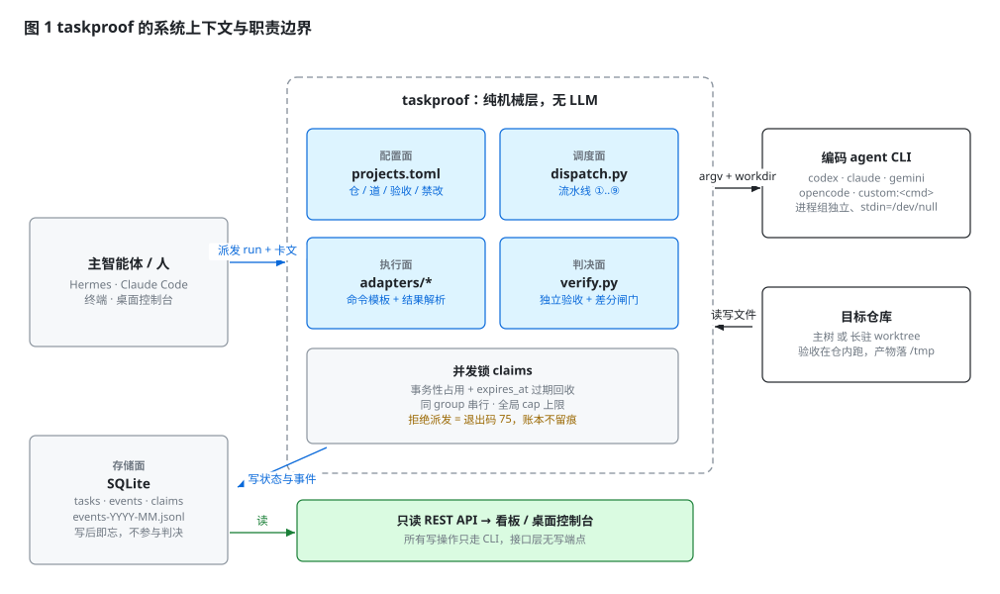
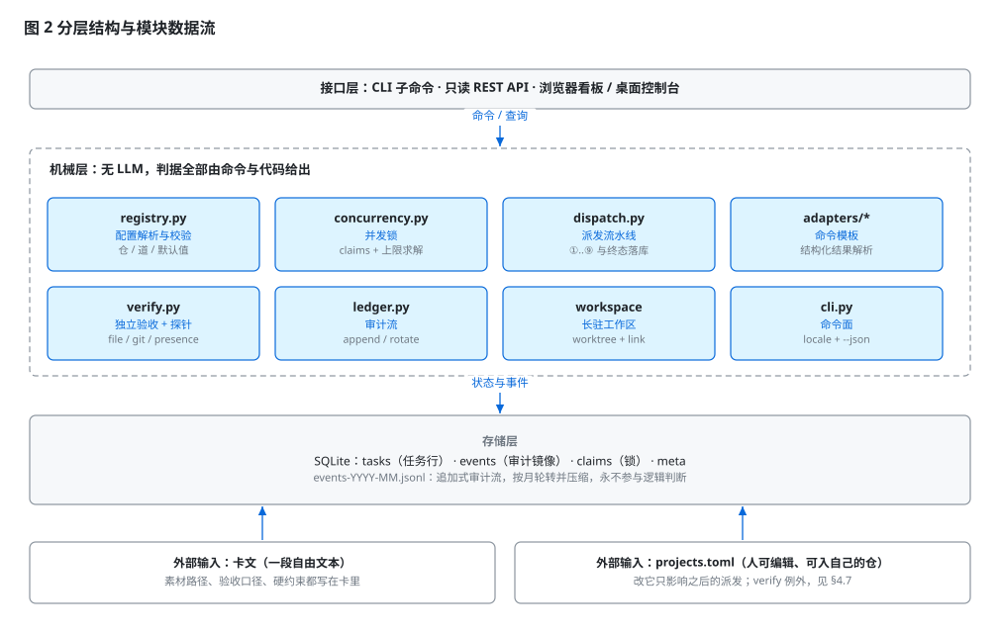
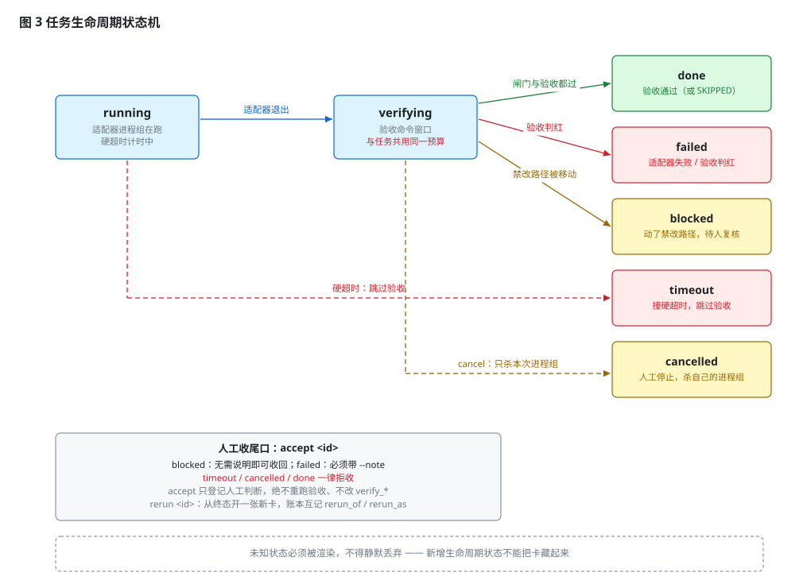
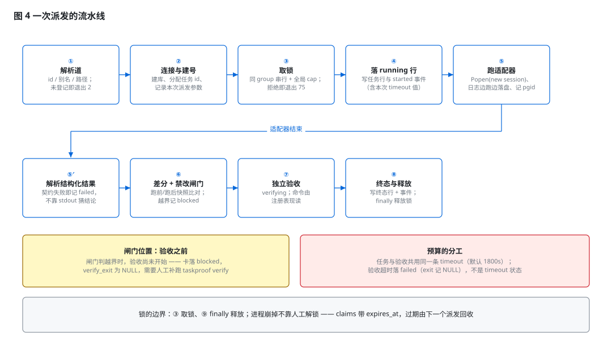
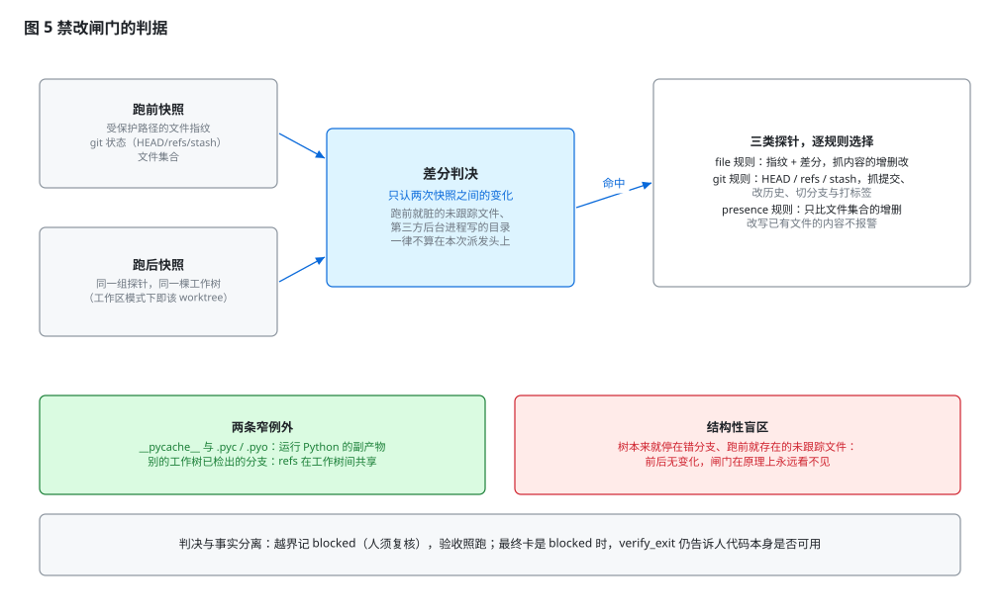
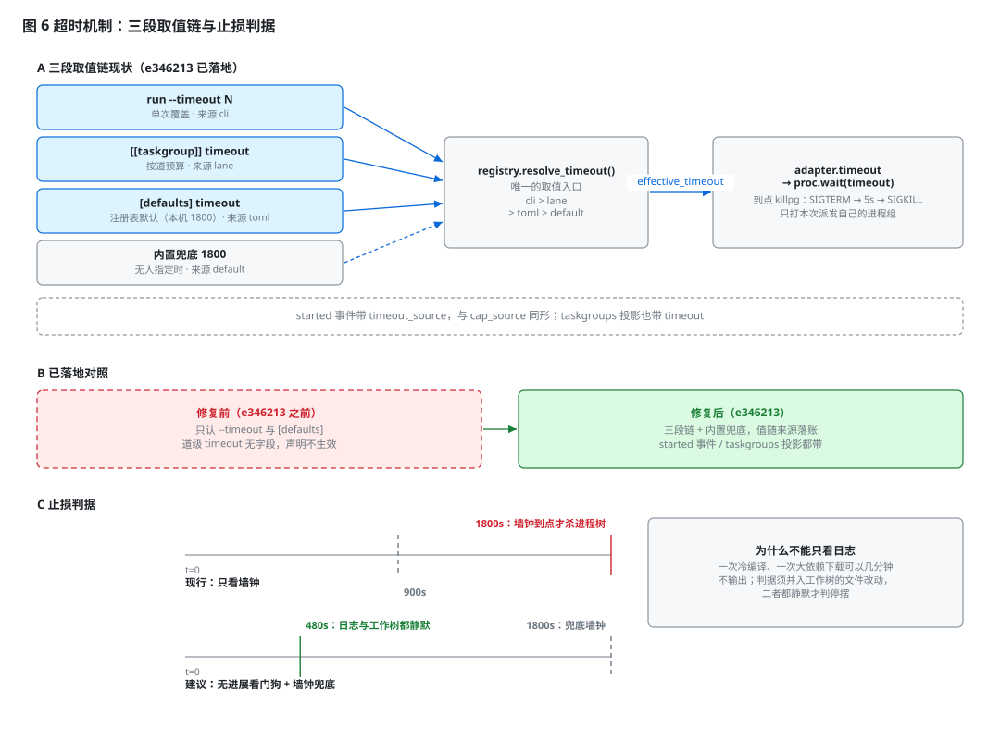

# 整体设计

[English](ARCHITECTURE.md) · **简体中文**

> 观测快照：2026-10-14，针对 v0.3.0。第 2 至第 4 章描述**现行行为**并逐条给出 `文件:行号`；
> 第 5 章是实测；第 6 章是**未落地的改进设计**，不得当作已发布行为来读。
> 本设计的决策记录与不变量见 [`DESIGN.zh-CN.md`](DESIGN.zh-CN.md)。

## 摘要

taskproof 是一层不产生判断的调度与验收设施：它不决定要做什么，只保证「派出去的活必被独立验收，且必被如实记账」。
其设计针对编码智能体的一类系统性风险——**自述与事实可以不一致**：声称已验证而事件流中并无验证动作、
声称完成而验收判红、越界动用禁止触碰的路径。为此，本设计把"下判决"的权力从执行体手中完全收回：
验收命令由配置侧给出并在智能体退出后独立执行，禁改判定由跑前/跑后差分给出，终态由机械层写入关系数据库，
审计流只追加且永不被回读。本文给出系统上下文、数据模型、八项关键机制、一次针对超时链路的实测评估，
以及七项缺陷与相应的改进设计；其中"按道超时"一项已经落地（`e346213`），其余仍在提案状态。

关键词：调度设施；独立验收；禁改路径；差分判据；硬超时；无进展检测；追加式审计

## 1 绪论

### 1.1 动机

同类工具（多智能体编排、面向智能体的看板）竞争的是编排广度与界面，对执行体的可信度基本不设防。
本机数周的自用运行暴露出四类事实级失败：

    agent 自称"浏览器已验证 / 已截图" -> 事件流中没有任何浏览器动作
    agent 越界                      -> 用猜来的口令尝试一次登录 POST
    agent 的结构化结果被 markdown 代码块包住 -> 解析失败，看起来像什么都没做
    agent 报告成功                  -> 独立执行验收命令判红

四条的共同点是：**执行体的自述不可作为判决依据**。因此治理规则只有一句：
凡判决，必由被判决者之外的机制给出。

### 1.2 设计目标

    G1  派发即验收：验收命令来自配置，在智能体退出后执行，与它的自述无关
    G2  越界必留痕，且由机器归因
    G3  记录不可争辩：状态存关系库，事件只追加且永不参与逻辑
    G4  单点机械层：无 LLM、无编排脑、无自动 git 写操作
    G5  并发可解释：上限永远与其来源一起显示

### 1.3 非目标

    不做任务分解、失败诊断与重试策略
    不做多智能体对话层，不做代码生成与编辑
    不自动提交、不自动推送 —— 一切 git 写操作属于人

### 1.4 术语

    道 / taskgroup   一个可派发单位：id、归属项目、路径、验收命令、禁改路径
    仓 / project     一个仓库身份与默认路径；本身不可派发
    卡 / brief       交给智能体的自由文本任务说明
    派发             一次 run 调用，对应任务表里的一行
    工作区           系统为某条道创建并长期复用的 git worktree

## 2 总体设计

### 2.1 职责边界

系统的边界由一件事划定：**哪些环节机器可以判，哪些只能人判**。

    机器可判   进程是否还活着、命令退出码、受保护路径的前后差分、
               验收命令的退出码、并发槽位是否已满
    人可判     一次越界是否可接受、一次判红是否属于假红、半成品是否值得保留

因此写面被压到最小：CLI 是唯一的写入口，REST 接口**只读**，桌面控制台与浏览器看板共用同一份渲染层。
这条边界使"谁能改变系统状态"成为一个可枚举的问题，而不是需要靠审计日志事后还原的问题。

### 2.2 分层与模块

实现分为三层。接口层只做参数解析与呈现；机械层不含大模型调用，所有判据由命令与代码给出；
存储层把状态（SQLite，被逻辑查询）与审计（JSONL，永不被回读）分开。

    registry.py     解析并校验 projects.toml（仓 / 道 / 默认值 / 禁改规则）
    concurrency.py  并发锁与全局上限求解，取值永远带来源
    dispatch.py     派发流水线 ①..⑨，唯一的任务状态写入者
    adapters/*      「一条命令模板 + 一种结果解析约定」：codex、claude、
                    gemini、opencode、custom:<cmd>
    verify.py       独立验收与三类差分探针
    ledger.py       审计流的追加与轮转，从不被查询
    cli.py          命令面（本地化的人类输出 + --json 机器输出）

### 2.3 配置与运行时状态的分离

配置是 `projects.toml`：人可编辑、可进用户自己的版本库、改动生效于**之后的**派发。
运行时状态一律进 SQLite。两者不交叉的理由是：配置文件的一个笔误不应污染历史记录，
而历史记录也不应成为配置的隐式默认值来源。

有效值一律与其来源同时显示（`taskproof config --show`）：

    concurrency = 5（projects.toml）
    timeout     = 1800（projects.toml）

该约定来自 G5：全局上限有三个可能来源——命令行 `run --cap N`、注册表 `[defaults] concurrency`、
机器探测兜底（`clamp(2, 核数 // 4, 6)`；内存小于 8 GB 取 2；核数不可用取 3，`concurrency.py:114`）。
只显示数值会造成"为什么只有 5 个槽位"这类无法回答的问题。

### 2.4 技术选型与约束

    Python 3.11+，仅标准库（sqlite3 / subprocess / json / http.server /
        argparse / tomllib）
    安装用 pipx，支持 --editable：改源码即刻生效
    许可 Apache-2.0：本工具的价值取决于被采纳，故不取传染性许可
    合规约束：仓库内不得出现组织相关的词与私网地址。随仓库发布的扫描规则只描述
        "形状"，组织词表放在仓库之外（~/.taskproof/asset-patterns.txt）

## 3 数据模型与生命周期

### 3.1 关系模式

> 表 1 —— `src/taskproof/sql/schema.sql`

    tasks     id / project / group_name / brief / status / adapter / model /
              reasoning / attempt / exit_code / pid / pgid / workdir / result_path /
              verify_cmd / verify_exit / files_changed / created_at / started_at /
              finished_at
    events    审计镜像，与 JSONL 同源：id / task_id / ts / event / payload
    claims    并发守卫：scope（group:<组> | global） / task_id / pid / claimed_at /
              expires_at
    meta      键值杂项

两处取舍值得单独记录。其一，注册表分成两层后，`tasks.project` 存的是**道 id**，
`group_name` 存的是锁名（缺省等于道 id；两条道可显式共用一个锁名）——旧行无需迁移即保持可读。
其二，并发不用锁文件而用带 `expires_at` 的 `claims` 表：进程崩溃后由下一次派发按过期回收，
不留下需要人工清理的残留锁。

### 3.2 审计流为何不参与查询

状态库回答"现在是什么状态"，审计流回答"发生过什么"。审计流只追加（`ledger.py:37`），
按月轮转并压缩（保留 6 个月），并且能容忍被截断的行。它在架构上**永远不用于判断**
（`dispatch.py:405` 起的写入路径同时落 SQLite 与 JSONL）。这条分工消掉了"两份真相"问题：
账本可以丢，判决不受影响。

### 3.3 生命周期

五个终态：`done` / `failed` / `blocked` / `timeout` / `cancelled`。

    running     适配器进程组在跑，硬超时计时中
    verifying   验收窗口 —— 状态刻意先于命令写入，使挂死的验收也可见
    done        验收通过，或被记录为 SKIPPED
    failed      适配器失败，或验收执行后判红
    blocked     受保护路径被移动，需要人工复核
    timeout     撞上硬超时，进程树被杀，验收从未执行
    cancelled   人工停止（只杀本次派发自己的进程组）

### 3.4 终态语义与人工收尾

`blocked` 表达的是"需要人复核"，不是"活干坏了"：越界是关于本次运行的事实，不是对产物的判决，
因此与 `failed` 严格分离。越界不短路流水线——验收照跑，两条事实同时落账
（`forbidden` 事件给出越界路径，`verify` 事件给出真实验收结果），且越界优先于验收判红。

人工收尾口是 `accept <id>`，它是一次**登记**而非判决：不重跑验收、不改 `verify_*`。
`blocked` 无需说明即可收回（绿验收升 `done`，红或被跳过的验收落 `failed`）；
`failed` 必须带 `--note`，因为被清掉的失败必须留在账上。`timeout` 与 `cancelled` 一律拒收
（`dispatch.py:1922`）。重做是独立动作：`rerun <id>` 从终态开一张新卡，并在账本中互记
`rerun_of` / `rerun_as`。

两条硬约束：未知状态必须被渲染、不得无声丢弃；`accept` 绝不能静默改写它所关闭的那次运行的事实。

## 4 关键机制

### 4.1 派发流水线

一次派发是九步的直线过程，其中第 ⑤ 步占绝大部分时间。

    ① 解析道（id / 别名 / 路径）；未登记即退出 2
    ② 准备并连接工作区（按需建库）
    ③ 取锁：同组串行 + 全局上限；被拒即退出 75，且账本不留痕
    ④ 写 running 行与 started 事件（本次的 timeout 与 cap，各自带来源）
    ⑤ 跑适配器：Popen 且 start_new_session，stdin 接 /dev/null，
        stdout/stderr 边跑边落 logs/<id>.log，记录 pgid，同时开始硬超时计时
    ⑤′ 解析结构化结果；解析失败按适配器失败处理，判决绝不从 stdout 猜
    ⑥ 差分 + 禁改闸门
    ⑦ 独立验收（先写 verifying 状态）
    ⑧ 终态行与事件；锁在 finally 中释放

两个后果值得强调：闸门（⑥）在验收（⑦）**之前**，所以判越界的那次运行验收根本没跑，
其 `verify_exit` 为 NULL，要拿到验收事实须由人补跑 `taskproof verify <id>`；
锁的释放放在 `finally`，与运行如何结束无关。

### 4.2 并发控制

    同组串行    一把硬锁，撞上即退出 75，与文件是否重叠无关
    全局上限    --cap > [defaults] concurrency > 机器探测兜底
    锁的存活    claims.scope = group:<组> | global，expires_at = 本次 timeout + 60 秒
    崩溃回收    过期锁由下一次派发删除；不存在需要人工解锁的状态

被拒的派发不写账本，所以"没发出去"与"发出去了但没跑"不会被混淆。收紧上限不追溯：
它打印在飞卡及其已用时长，但不杀任何进程。

### 4.3 工作区隔离

两种隔离手段并存，用途不同：

    道的工作区   注册表声明 workspace = "worktree"：系统为该道惰性创建一棵长驻工作树并
                 复用；link 把主树的依赖目录软链进来，免重装；运行目录 = 道路径在该
                 工作树中的对应位置
    --worktree   一次性检出（<仓父目录>/<仓名>-wt-<任务id>）；跑完仍干净即删，
                 有改动即保留并打印，两种情况都记 worktree 事件

默认值是 `none`（就地跑），这是刻意的：注册表里的验收命令常含指向主树的绝对路径，
若把运行搬进工作树执行，验收会静默地对主树下判决——"绿了"而真正被改的那棵树没人验。
Python 虚拟环境刻意不参与依赖探测：其配置与控制台脚本写死了绝对路径。

### 4.4 差分式禁改闸门

闸门只回答一个问题：**本次运行是否移动了受保护的路径**。它必须不信任智能体，也不冤枉它。

第一条规则：信号是差分，不是快照。闸门在适配器启动前记录受保护状态，退出后再记录一次，
只认两次快照之间发生的变化。仓库原本就可能脏（Finder 的 `.DS_Store`、未跟踪的草稿目录、
半成品构建产物），当前态快照会把世界的噪音算在每次派发头上。

第二条规则：一条规则一种探针，由被保护的对象选择，并把探针类型带在审计事件上。

    file      指纹与 git status 差分：内容的增删改
    git       HEAD / refs / stash：提交、改历史、切分支、打标签、stash
    presence  只比较文件集合的增删；内容改写不报警，换取对后台写盘进程的高精度

第三条规则：两类窄例外，都属"世界的噪音"。解释器自身的产物（目录段名为 `__pycache__`，
或以 `.pyc` / `.pyo` 结尾）在任何规则下都跳过——否则"禁止触碰这个 Python 源码目录"这条规则
会在第一次 import 时误报。又因 `refs/heads/*` 在仓的所有工作树间共享，闸门在比较 refs 前
剔除**别的工作树已检出的分支**，使主树的提交无法冤枉跑在工作树里的卡（无第二棵工作树时，
快照逐字节不变）。

第四条规则：`presence:` 不是豁免名单。类型前缀只为**自己这一条**规则选择探针，
在 `t/` 规则旁边加一条 `presence:t/__pycache__/` 并不能把字节码从 `t/` 下挖出来。

以及一条结构性盲区：闸门只看两次快照之间是否变化，因此**跑前就存在的**状态它看不见——
树本来就停在错分支、跑前就已存在的未跟踪文件。

### 4.5 独立验收

验收命令由注册表给出，经 `/bin/sh -c` 执行（需要 `&&`、`.`、重定向等真实 shell 能力，
因此用显式 shell 字符串而非 `shlex.split`）。约定一：没有验收命令不等于通过，记 SKIPPED。
约定二：验收超时是失败（退出码记 NULL 并在注记中说明），不是错误。

验收命令**运行时现读注册表**（`dispatch.py:753`），这与禁改规则不同：禁改规则在发车那一刻
被快照进任务的 `started` 事件，之后改它对在飞卡无效；而改 `verify` 会立即改掉在飞卡的
验收命令。

### 4.6 结构化结果契约

适配器若支持结构化输出，则把 `schemas/result.json` 作为输出约束传入：
`status ∈ {done, partial, blocked, rejected}`，另有 `summary`、`files_changed[]`、`verify`、
`blockers`、`needs_approval`、`contract_dispute`，且全部必填。契约在两个方向保持同一含义：
智能体自述的 `status` 是**输入**，而终态仍由闸门与验收命令给出。

### 4.7 超时与进程终止

现行超时是单一墙钟预算，取值走三段声明源加一个内置兜底，并且永远与来源一起显示。

    run --timeout N       单次覆盖                    来源 cli
    lane.timeout          道自己的预算                来源 lane
    [defaults] timeout    注册表默认（本机 1800 秒）    来源 toml
    内置 1800             无人指定时                  来源 default

    registry.resolve_timeout(taskgroup, defaults, cli)   唯一的取值入口
    dispatch.py:204       effective_timeout = resolve_timeout(...)

    started 事件带 timeout_source，与既有的 cap_source 同形；
    taskproof taskgroups 也在每条道记录上报告 timeout

到期后的处置是机械的，且被限定在本次派发自己的进程组内：`proc.wait(timeout)` 抛出后，
`_terminate_tree` 只对该进程组发 SIGTERM、宽限五秒、再发 SIGKILL（`dispatch.py:908`）；
若组 id 与自身相等则退化为只杀该子进程，因此调度器不可能杀掉自己。`pgid` 在子进程出现后
立即落库，故即使进程已被重启，`cancel` 仍能触达同一进程组（`_terminate_recorded_group`，
`dispatch.py:980`）。随后写终态 `timeout`、`exit_code` 沿用验收语义（71）、追加 `timeout` 事件，
而**验收被跳过**——`verify_exit` 保持 NULL。

任务与验收共用这一条预算：验收命令拿到的就是同一个 `effective_timeout`（`dispatch.py:754`）。

同名的另一处超时与此无关：`taskproof wait --timeout`（默认 600 秒，`cli.py:138`）
只约束等待命令本身。

### 4.8 退出码不等于任务状态

    0 成功 / 2-3 注册表问题 / 64 用法错误 / 70 适配器失败 / 71 验收或产物自检失败 /
    75 并发受限

退出码说的是**命令怎么结束的**，不是任务被记成了什么，两者刻意解耦：一次越界运行状态为
`blocked`，而 `run` 仍以 71 退出（与任何验收失败同映射）。关心产物可不可用的人读状态，
只关心命令结果的人读退出码。

## 5 实测与评估

### 5.1 数据来源

一个自用工作区，观测日 2026-10-14，数据取自三处可回读的账本：任务表
（`taskproof --json tasks --all`）、单卡事件流（`--json show <id>`）、当月事件流文件
（1271 行）。该工作区的注册表含 28 条道、8 个项目。

### 5.2 运行分布

> 表 2 —— 213 张卡的状态与适配器分布

    done 181 / cancelled 20 / timeout 6 / failed 5 / blocked 1
    adapter: codex 211；custom:<cmd> 2

这个分布本身是对设计的弱信号：异常终态合计 32 张（15%），其中 `blocked` 只有 1 张，
说明禁改闸门并未变成一台持续误报的机器。六张 `timeout` 全部撞在同一个默认值上。

### 5.3 超时链路实际发生了什么

> 表 3 —— 在作者的工作区上实测

    六次超时全部为默认值 1800 秒，每一次的事件流都写着：
      adapter 'codex': timeout after 1800s (process tree terminated)
    逐卡：五张在同一天，一张稍晚；最后一张（t-20261014-011）跑了
      14:47:27 -> 15:17:27，终态 status=timeout、exit_code=71、verify_exit=NULL，
      日志末段显示 worker 仍在反复寻找访问本地开发端点的途径 —— 也就是说它从未停止
      尝试，因而任何墙钟都分不清"在干活"与"在空转"

    从未生效的道级声明（该注册表里有 22 处）：
      web-lane-a   声明 2700   started 事件记录 1800（2 次）
      web-lane-b   声明 5400   started 事件记录 1800（1 次）
      pack-lane    声明 5400   started 事件记录 1800（1 次）
      事件流里出现过 2700 / 3600 / 5400 的那些卡，全部来自命令行显式 --timeout，
      与注册表无关

结论：超时的**执行**是可靠的——进程树被杀、状态与事件一致、验收确实没有跑。
超时的**配置**是坏的。按道限制在今天并不存在；给某条道换一个预算的唯一途径，
是每次发车都记得带上 `--timeout`，那是靠记忆的纪律，而不是机器闸门。

更新（`e346213`）：该缺陷已修复。注册表里共 **22 条道级声明**——19 条在
`[[taskgroup]]` 上，另 3 条在旧式 `[[project]]` 块上（旧块即道，所以同样生效）。
修完后 `taskproof --json taskgroups` 里 22 条 `timeout` 全部非 null。

### 5.4 缺陷归纳

> 表 4 —— 现行实现的问题清单

    D1  道级 timeout 声明被无声丢弃                        —— 已在 e346213 修复
        Taskgroup 无该字段（models.py:43-73），加载注册表也不拒绝未知键
        （registry.py:491），于是 22 处声明什么也没做，而且没有任何提示。
        这与"配置即契约"的取向直接对立。现由 e346213 补上字段，
        `registry.resolve_timeout` 读道级 `timeout`（来源 lane），并在
        `started` 事件里落账 `timeout_source`。

    D2  所有场景共用一条墙钟预算
        打包类道需要 5400 秒；而"在找入口上烧时间"的卡应远早于 1800 秒止损。
        一个全局常量两端都不满足：既误杀重活，也放跑浪费。

    D3  没有进展信号
        墙钟分不清"在干活"与"在空转"。5.3 的那张卡在整整 1800 秒里持续输出、持续尝试，
        机制上无法在没有人的情况下提前止损。

    D4  超时无法被人工收尾
        accept 只收 blocked 与 failed（dispatch.py:1922），所以撞超时卡的半成品既不能被
        登记，也不能连同它的验收证据一起保留；唯一出路是 rerun，等于把同样的时间再付一次。
        没有工作区的道，半成品直接留在主树，需要人手工辨析。

    D5  验收与任务共用预算
        一条预算被两个阶段分食：任务跑得越久，验收可用时间越少。验收自身超时被记为
        failed（exit 记 NULL），与"任务撞自己的超时"是两个不同状态、不同语义。

    D6  两项配置的生效时机不同
        禁改规则在发车时快照，验收命令运行时现读。同样的"改注册表"动作，
        对已经在跑的卡作用相反。

    D7  结构性盲区不可见
        闸门只比快照，故"树本来就停在错分支"永远不可能被发现，而注册表没有 `branch`
        键（见 [`REGISTRY.zh-CN.md`](REGISTRY.zh-CN.md)）。现行缓解办法是在道的 `verify`
        命令开头手写一段分支断言，代价是每加一条道都要记得写一遍。

## 6 改进设计

除已标注者外，以下均未落地。

### 6.1 按道超时与三段取值链   —— 已在 e346213 落地

这一项已经落地。`Taskgroup` 现在带一个可选的 `timeout`，取值就是图 6 的 A 组那条链，
值与来源一并落账：

    --timeout N          单次，最高优先        来源 cli
    lane.timeout         按道预算              来源 lane
    [defaults] timeout   兜底                  来源 toml
    内置 1800             无人指定时            来源 default

`registry.resolve_timeout` 是这条链唯一的读取处；`started` 事件现在带 `timeout` 与
`timeout_source`，与既有的 `cap_source` 同形，`taskproof taskgroups` 也在每条道记录上
报告 `timeout`。收益是已经写下的声明立刻成为真闸门，重活与轻活可以在同一次并行中各自成立。

### 6.2 验收预算分离

给验收单独一个键，缺省沿用任务预算，使既有道的行为不变。这样"任务用满了预算"与
"验收用满了预算"不再互相蚕食，两者各自携带自己的语义落账。

### 6.3 无进展看门狗

在墙钟之外增加第二条止损条件，见图 6 的 C 组：

    停摆 ⟺ 日志文件与工作树都静默超过 idle 预算（建议 480 秒）

只对 `running` 生效，可在道上关闭，并且应先默认关闭以观察误报率。为什么不能只看日志：
一次冷编译、一次大依赖下载可以几分钟不输出，所以判据必须并入工作树的活动，
只有两者都静默才算停摆。墙钟仍作为兜底保留。对照 5.3 的样本，这条能把 1800 秒的浪费
压到八分钟量级。

### 6.4 超时终态的可收尾性

把 `accept` 的受理面扩到 `timeout`，并强制带说明：超时卡的产物天然是半成品，
登记只能表达"人已看过这份半成品"，绝不能升格为 `done`。建议引入独立终态
（例如 `salvaged`）并在看板上单独计数，使半成品不混入完成数。拒绝矩阵仍要保留：
`done` 与 `cancelled` 继续拒收。

### 6.5 配置生效时机的一致化

把 D6 的二选一固定下来，并向读者显示是哪一种。建议统一为"发车时快照 + 事件留痕"：
在飞卡不会被之后的改动改变，而改配置的人能看出改动只影响之后的派发。

### 6.6 未知键显式化

加载注册表时收集未识别的键，由 `taskproof projects` 与 `doctor` 报告。
那 22 处悬空声明正是"静默忽略"的产物；把它变成告警，既消除 D1 的复发路径，
也不改变任何现有退出码。D7 的根治意味着给注册表加分支键，属于较大的改动，
应单独评估。

## 7 改进的验证方式

每项改进都要配上可机器执行的判据，并沿用本项目已有的口径：

    按道超时   已用下列判据验证（e346213 用的就是它们）：
               单元：三段取值链各一例，外加来源字段断言
               端到端：道声明 timeout = 2，不带 --timeout 发车，必须以 exit 71 落 timeout
               回归：无声明且无参数时仍是 [defaults] 的值
    验收预算   单元：任务与验收分别超时，断言各自终态与 verify_exit 语义
    看门狗     假阴：模拟"长编译静默"的探针不得被判停摆
               假阳：日志与工作树同时静默必须被判停摆并落账
    超时可收尾 拒绝矩阵：done / cancelled 仍拒收；timeout 无 --note 拒收；带 --note 可登记
    未知键     单元：含未识别键的注册表应给出告警，且退出码不变
    仓库合规   提交前 python3 tools/scan_assets.py 必须 clean

所有端到端断言一律走 `custom:` 适配器，且探针命令必须打印点什么
（裸 sleep 会被判"无输出可解析"）；派发一律以后台进程发出，并从账本回读终态。

## 8 结论与局限

判决面是可信的：验收独立于自述，越界由差分而非信任判定，状态与审计分家。
薄弱处落在**配置面**——一个曾被无声丢弃的键（D1，已在 e346213 修复）与一条被两个阶段
分食的预算（D2、D3，仍未闭合），两者都在六次超时与 22 处悬空声明上留下了痕迹。
改进的方向不是加强对运行的执行，而是让配置与止损规则拿到与系统其余部分相同的机械地位。

局限：

    样本规模   六次超时、一台机器、约一个月的事件流；不构成统计意义上的评估
    方法       单站点观察研究；无对照组，未做受控实验
    终态分布   20 张 cancelled 混合了人工中断与工具性重发，未逐张归因
    未覆盖     桌面宿主与浏览器宿主共用渲染层时的降级路径

## 附录 A 复现命令

    taskproof config --show                             # 上限与超时的有效值及来源
    taskproof projects ; taskproof taskgroups           # 机器眼中的注册表
    grep -c '^\[\[taskgroup\]\]' ~/.taskproof/projects.toml
    grep -n '^timeout' ~/.taskproof/projects.toml       # 道级声明

    taskproof --json tasks --all --limit 2000           # 任务行：status / exit_code / verify_exit
    taskproof --json show <任务id>                       # 单卡：started(timeout=…) -> timeout
    grep -c '"event": "timeout"' ~/.taskproof/events-YYYY-MM.jsonl

    # 值 vs 来源，按道统计：
    python3 - <<'PY'
    import collections, json, os
    c = collections.defaultdict(collections.Counter)
    for line in open(os.path.expanduser('~/.taskproof/events-YYYY-MM.jsonl')):
        e = json.loads(line)
        if e.get('event') == 'started':
            p = e.get('payload') or {}
            c[p.get('group')][p.get('timeout')] += 1
    for lane, n in sorted(c.items(), key=lambda kv: str(kv[0])):
        print(lane, dict(n))
    PY

## 附录 B 代码索引

    src/taskproof/sql/schema.sql        关系模式
    src/taskproof/models.py:43-73       道的数据结构（现无 timeout 字段）
    src/taskproof/registry.py:371       reg.timeout 只读 [defaults]
    src/taskproof/registry.py:491       道字段的校验与读入
    src/taskproof/concurrency.py:114    机器探测兜底上限
    src/taskproof/dispatch.py:201       超时取值的唯一入口
    src/taskproof/dispatch.py:226       锁的 ttl = 本次超时 + 60 秒
    src/taskproof/dispatch.py:489-566   跑适配器与超时处置
    src/taskproof/dispatch.py:548       timeout 终态（exit_code 沿用 71）
    src/taskproof/dispatch.py:908       _terminate_tree：SIGTERM -> 5 秒 -> SIGKILL
    src/taskproof/dispatch.py:980       _terminate_recorded_group：按落库 pgid 杀
    src/taskproof/dispatch.py:753       验收命令现读注册表
    src/taskproof/dispatch.py:754       验收与任务共用同一条超时
    src/taskproof/dispatch.py:1922      accept 只受理 blocked / failed
    src/taskproof/verify.py:76-140      独立验收与超时语义
    src/taskproof/schemas/result.json   结构化结果契约
    tools/make_figures.py               生成本文全部配图，双语两套
